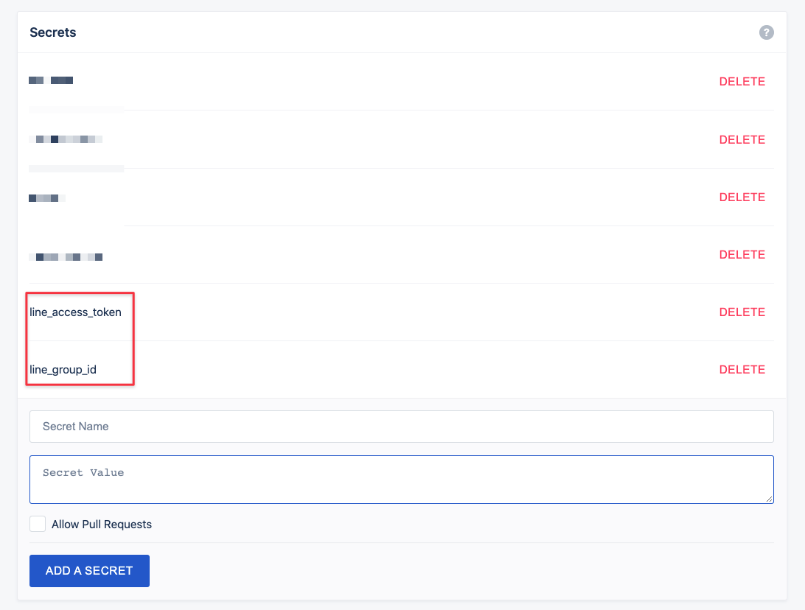

# Readme
1. You have to setting Line Channel and get accecc token and user id/ room id / group id
2. Setting Drone Environment, [to] can setting userId, groupId, or roomId
3. Follow the step in your drone pipeline

```
docker build -t drone-line-hazel
docker run drone-line-hazel
docker push tinazx056/drone-line-notify
```

若要在台灣時間的週六、週日略過推播，可在 `.drone.yml` 的 `settings` 加上 `skip_weekend: true`。Drone 會將它傳為 `PLUGIN_SKIP_WEEKEND="true"`；未設定或設為其他值時照常推播。判斷一律以台灣時間（UTC+8）為準。

## drone.yml
Drone Setting Environment
- line_access_token
- line_group_id



``` yml
kind: pipeline
name: default

steps:
- name: 🤖 LineBot Notify
  image: tinazx056/drone-line-notify
  settings:
    access_token:
      from_secret: line_access_token
    to: 
      from_secret: line_group_id # You can use userId, groupId, or roomId
  when:
    status:
    - failure
    - success
```
